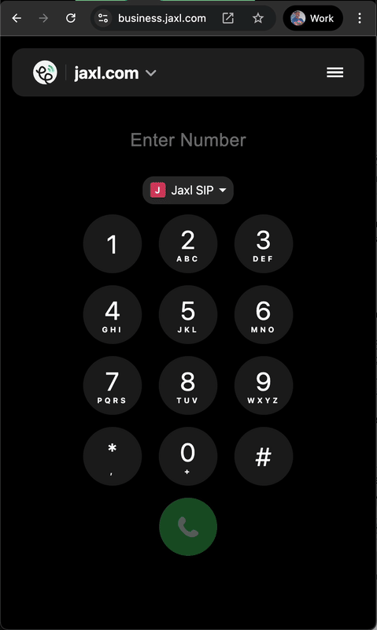

# Jaxl CLI & Jaxl Python API Client

Use Jaxl from Python code or directly via the `jaxl` command-line tool.

1. [Install](#install)
2. [JAXL CLI](#jaxl-cli)
   - [Setup](#setup)
   - [Verify API Credentials & Auth Token](#verify-api-credentials--auth-token)
   - [Check Account Balance](#check-account-balance)
   - [Create an IVR](#create-an-ivr)
   - [Create a hangup IVR](#create-a-hangup-ivr)
   - [Configure IVR Options](#configure-ivr-options)
   - [List IVRs](#list-ivrs)
   - [List Purchased Jaxl Numbers](#list-purchased-jaxl-numbers)
   - [Assign a Phone Number to IVR by ID](#assign-a-phone-number-to-ivr-by-id)
   - [Place Outgoing Cellular Call with Existing IVR](#place-outgoing-cellular-call-with-existing-ivr)
   - [Place Outgoing Cellular Call with Ad-hoc IVR](#place-outgoing-cellular-call-with-ad-hoc-ivr)
   - [Dial-out 2-Party Conference with Ad-hoc IVR](#dial-out-2-party-conference-with-ad-hoc-ivr)
   - [Add External Phone Number to an Active Call](#add-external-phone-number-to-an-active-call)
   - [Add External Phone Number via Another Phone Number to an Active Call](#add-external-phone-number-via-another-phone-number-to-an-active-call)
   - [Add Agent to an Active Call](#add-agent-to-an-active-call)
   - [Remove External Phone Number from an Active Call](#remove-external-phone-number-from-an-active-call)
   - [Remove Agent from an Active Call](#remove-agent-from-an-active-call)
   - [Send Text Prompts (TTS) in an Active Call](#send-text-prompts-tts-in-an-active-call)
   - [Play Audio File in an Active Call](#play-audio-file-in-an-active-call)
   - [Mute a Participant in an Active Call](#mute-a-participant-in-an-active-call)
   - [Unmute a Participant in an Active Call](#unmute-a-participant-in-an-active-call)
   - [Hold a Participant in an Active Call](#hold-a-participant-in-an-active-call)
   - [Unhold a Participant in an Active Call](#unhold-a-participant-in-an-active-call)
   - [Get call details](#get-call-details)
   - [Transfer an Active Call](#transfer-an-active-call)
   - [Run a Campaign on a Custom IVR](#run-a-campaign-on-a-custom-ivr)
   - [Receive Call Events via Webhook IVRs](#receive-call-events-via-webhook-ivrs)
   - [Realtime Streaming Audio](#realtime-streaming-audio)
   - [Realtime Streaming Speech Segments](#realtime-streaming-speech-segments)
   - [Realtime Streaming Transcriptions per Speech Segment](#realtime-streaming-transcriptions-per-speech-segment)
   - [AI Agent: Realtime Transcriptions STT ➡️ LLM/MCP ➡️ TTS](#ai-agent-realtime-transcriptions-stt-️-llmmcp-️-tts)
   - [List Subscriptions Payments](#list-subscriptions-payments)
   - [List Consumable Payments](#list-consumable-payments)
   - [List Integrations](#list-integrations)
   - [Add an Integration](#add-an-integration)
3. [Jaxl Python SDK](#jaxl-python-sdk)
   - [SDK Example Usage](#sdk-example-usage)
4. [JAXL HTTP Webhook Protocol](./SPECIFICATION.md)
5. [SDK Documentation](#sdk-documentation)
6. [Status](#status)

## Install

`pip install -U jaxl-python`

## JAXL CLI

```bash
jaxl -h
usage: jaxl [-h] {accounts,apps,calls,campaigns,devices,integrations,ivrs,kycs,members,messages,notifications,orgs,payments,phones,teams} ...

Jaxl CLI

positional arguments:
  {accounts,apps,calls,campaigns,devices,integrations,ivrs,kycs,members,messages,notifications,orgs,payments,phones,teams}
    accounts            Manage Accounts
    apps                Manage Apps for Webhooks and Streaming audio/speech/transcriptions.
    calls               Manage Calls (Domestic & International Cellular, App-to-App)
    campaigns           Manage Campaigns
    devices             Manage Devices
    integrations        Manage Integrations
    ivrs                Manage IVRs (Interactive Voice Response)
    kycs                Manage KYCs
    members             Manage Members
    messages            Manage Messages (SMS, WA, RCS, Email, App-to-App)
    notifications       Manage Notifications (Android, iOS, Web)
    orgs                Manage Organizations
    payments            Manage Payments
    phones              Manage Phones (Landline, Mobile, TollFree)
    teams               Manage Teams (Managers, Phones)

options:
  -h, --help            show this help message and exit
```

### Setup

You will require the following to successfully run `jaxl` command line tool:

- `JAXL_API_CREDENTIALS`: Required to connect with Jaxl API Infrastructure
- `JAXL_API_AUTH_TOKEN`: Ensure necessary permissions are added to generated auth token.

Please visit [Jaxl Business Website](https://business.jaxl.com) or download the [Jaxl Business Android](https://play.google.com/store/apps/details?id=com.jaxl.business) or [Jaxl Business iOS](https://apps.apple.com/app/id6451118240) mobile application to access your credentials and auth tokens.

[](https://github.com/jaxl-innovations-private-limited/jaxl-python#setup)

Finally, setup following environment variables when trying `jaxl` command line.

```bash
export JAXL_API_CREDENTIALS=/path/to/jaxl-api-credentials.json
export JAXL_API_AUTH_TOKEN="....authentication token...."
```

### Verify API Credentials & Auth Token

```bash
jaxl accounts me
```

### Check Account Balance

```bash
jaxl accounts balance
```

### Create an IVR

```bash
jaxl ivrs create \
  --message "Hello, we are calling via Jaxl IVR demo created from CLI"
```

### Create a hangup IVR

This IVR will speak the message and then hangup the call.

```bash
jaxl ivrs create \
  --message "Hello, we are calling via Jaxl IVR demo created from CLI.  Will hang up after speaking this message" \
  --hangup
```

### Configure IVR Options

This IVR option uses `--next` to send user to another IVR or to the same IVR for a "repeat this menu" experience.

```bash
jaxl ivrs options configure \
  --ivr <IVR ID TO CONFIGURE> \
  --input 0 \
  --message "Press 0 to repeat this menu" \
  --next <NEXT IVR ID>
```

> Use same value for &lt;IVR ID TO CONFIGURE&gt; and &lt;NEXT IVR ID&gt; to complete the "repeat this menu" experience.

One of the CTA key flag must be provided. Allowed CTA keys are:

- `--next`: Send to another IVR
- `--phone`: Send to an external phone number
- `--devices`: Send to devices by ID
- `--appusers`: Send to app users (org employees) by ID
- `--teams`: Send to teams by ID

### List IVRs

```bash
jaxl ivrs list
```

### List Purchased Jaxl Numbers

```bash
jaxl phones list
```

You can also search for a specific purchased number:

```bash
jaxl phones list --e164 "+CC<Purchased Jaxl Number>"
```

### List Organization Members

```bash
# all members
jaxl members list

# one member, by their email ID
jaxl members list --email "member@example.com"

# several members, repeat the flag per email ID
jaxl members list --email "member@example.com" --email "manager@example.com"

# several members, using shell brace expansion
jaxl members list --email={member@example.com,manager@example.com}

# shorter still when the domain is shared
jaxl members list --email={member,manager}@example.com

# You can pipe the output to grep to keep only the fields you need. For example, to print just the member id, user_id, app_user_id and email ID:

jaxl members list --email "member@example.com" \
  | grep -oP "\bid=\d+, user_id=\d+, app_user_id=\d+, email='[^']*'"
```


### Assign a Phone Number to IVR by ID

All incoming calls to this number will send user to the assigned IVR.

```bash
jaxl phones ivrs \
  --e164 "+CC<Purchased Jaxl Number>" \
  --ivr <IVR ID>
```

### Place Outgoing Cellular Call with Existing IVR

Below command will execute the following flow:

- Places a call to &lt;Callee Number&gt;
- When answered sends them to an existing IVR ID
- Once IVR finishes, call continues to CTA returned by IVR

```bash
jaxl calls create \
  --to "+CC<Callee Number>" \
  --from "+CC<Purchased Jaxl Number>" \
  --ivr <IVR ID>
```

### Place Outgoing Cellular Call with Ad-hoc IVR

Below command will execute the following flow:

- Creates an Ad-hoc IVR using `--message` and `--option` flags
- Places a call to <Callee Number>
- When answered sends callee to the ad-hoc IVR
- Once IVR finishes, call continues to CTA returned by IVR

```bash
jaxl calls create \
  --to "+CC<Callee Number>" \
  --from "+CC<Purchased Jaxl Number>" \
  --message "Hello, we are calling you from MyCompany" \
  --option "1=Press 1 for sales:teams=<Sales Team ID>" \
  --option "2=Press 2 for HR department:teams=<HR Team ID>
```

### Dial-out 2-Party Conference with Ad-hoc IVR

Below command will execute the following flow:

- Dials out to Doctor first
- When doctor answers the call, they are asked to press 1 when ready
- If doctor presses 1, a second call is placed to the patient
- Ends the call when one but all others have hanged up the call

```bash
jaxl calls create \
  --to "+CC<Doctors Number>" \
  --from "+CC<Purchased Jaxl Number>" \
  --message "Hello Doctor, this is a call from MyCompany regarding your appointment with Mr. Patient Name. When ready please, " \
  --option "1=Press 1 to connect with the patient:phone=+CC<Patient Number>"
```

### Add External Phone Number to an Active Call

```bash
jaxl calls add --call-id 1234 --e164 +CC<Mobile Number>
```

### Add External Phone Number via Another Phone Number to an Active Call

```bash
jaxl calls add --call-id 1234 --e164 +CC<Mobile Number> --from-e164 +CC<Purchased Jaxl Number>
```

### Add Agent to an Active Call

```bash
jaxl calls add --call-id 1234 --email <someone@mycompany.com>
```

### Remove External Phone Number from an Active Call

> **Coming soon** — documented ahead of the backend: this command is not in the CLI yet and there is no server-side participant control behind it today (tracked as F-193 in the Jaxl backend). Use `jaxl calls transfer` / `hangup` meanwhile.

```bash
jaxl calls remove --call-id 1234 --e164 +CC<Mobile Number>
```

### Remove Agent from an Active Call

> **Coming soon** — documented ahead of the backend: this command is not in the CLI yet and there is no server-side participant control behind it today (tracked as F-193 in the Jaxl backend). Use `jaxl calls transfer` / `hangup` meanwhile.

```bash
jaxl calls remove --call-id 1234 --email <someone@mycompany.com>
```

### Send Text Prompts (TTS) in an Active Call

```bash
jaxl calls tts --call-id 1234 \
  --prompt "Hello, this text was injected in the middle of an active call"
```

> Works on Jaxl-carried (SIP) calls of your own organization. The prompt is split on
> `.` into sentences and spoken to the call by Jaxl's TTS. Not available on calls
> carried by a BYO Twilio/Exotel account (the API returns 400).

### Send DTMF Digits into an Active Call

Drive the far side's IVR from your app (e.g. "press 1 for sales"):

```bash
jaxl calls dtmf --call-id 1234 --digits "1"
jaxl calls dtmf --call-id 1234 --digits "4521#"
```

> Alphabet `0-9 * # A-D`, at most 32 digits. Jaxl-carried (SIP) calls only.

### Play Audio File in an Active Call

> **Coming soon** — documented ahead of the backend: this command is not in the CLI yet and there is no server-side participant control behind it today (tracked as F-193 in the Jaxl backend). Use `jaxl calls transfer` / `hangup` meanwhile.

```bash
jaxl calls play --call-id 1234 --audio /path/to/a/file/on/local/disk/or/public/url
```

> NOTE: Audio file must be in SLIN16 format i.e. 8KHz Mono 16-bit.

### Mute a Participant in an Active Call

> **Coming soon** — documented ahead of the backend: this command is not in the CLI yet and there is no server-side participant control behind it today (tracked as F-193 in the Jaxl backend). Use `jaxl calls transfer` / `hangup` meanwhile.

Mute a specific cellular user in a call.

```bash
jaxl calls mute --call-id 1234 --e164 +CC<Mobile Number>
```

Mute an agent (Jaxl App User) in a call.

```bash
jaxl calls mute --call-id 1235 --email <someone@mycompany.com>
```

### Unmute a Participant in an Active Call

> **Coming soon** — documented ahead of the backend: this command is not in the CLI yet and there is no server-side participant control behind it today (tracked as F-193 in the Jaxl backend). Use `jaxl calls transfer` / `hangup` meanwhile.

Unmute a specific cellular user in a call.

```bash
jaxl calls unmute --call-id 1234 --e164 +CC<Mobile Number>
```

Unmute a specific agent (Jaxl App User) in a call.

```bash
jaxl calls unmute --call-id 1235 --email <someone@mycompany.com>
```

### Hold a Participant in an Active Call

> **Coming soon** — documented ahead of the backend: this command is not in the CLI yet and there is no server-side participant control behind it today (tracked as F-193 in the Jaxl backend). Use `jaxl calls transfer` / `hangup` meanwhile.

Put a cellular user on-hold in a call

```bash
jaxl calls hold --call-id 1234 --e164 +CC<Mobile Number>
```

Put an agent on-hold in a call

```bash
jaxl calls hold --call-id 1235 --email <someone@mycompany.com>
```

### Unhold a Participant in an Active Call

> **Coming soon** — documented ahead of the backend: this command is not in the CLI yet and there is no server-side participant control behind it today (tracked as F-193 in the Jaxl backend). Use `jaxl calls transfer` / `hangup` meanwhile.

Unhold a cellular user in a call

```bash
jaxl calls unhold --call-id 1234 --e164 +CC<Mobile Number>
```

Unhold an agent in a call

```bash
jaxl calls unhold --call-id 1235 --email <someone@mycompany.com>
```

### Get call details

```bash
jaxl calls get --call-id 1234
```

### Transfer an Active Call

All transfer commands need the call's `--call-id`. Find an active all's ID with:

```bash
jaxl calls list --active
```

Transfer to a phone number:

```bash
jaxl calls transfer --call-id 1234 --phone +CC<Mobile Number>
```

Transfer to a member by email. `--appusers` takes a Jaxl App User ID, not an email, so resolve it from `jaxl members list --email` first:

```bash
jaxl members list --email "member@example.com"
# note the `app_user_id` from the response, then:
jaxl calls transfer --call-id 1234 --appusers <app_user_id>
```

Transfer to a team by name. `--teams` takes a Jaxl Team ID, not a name, so resolve it from `jaxl teams list` first:

```bash
jaxl teams list | grep -oP "OrganizationGroupResponse\(id=\d+, name='[^']*'"
# find the matching team's name in the list, note its id, then:
jaxl calls transfer --call-id 1234 --teams <team_id>
```

Transfer to an IVR. `--next` takes an IVR ID, which you can find with `jaxl ivrs list`:

```bash
jaxl ivrs list --limit 100 \
  | grep -oP "IVRMenuResponse\(id=\d+, name='[^']*'" 
  
# note the matching IVR's id, then:
jaxl calls transfer --call-id 1234 --next <ivr_id>
```

Unlike the campaign override described in
[Run a Campaign on a Custom IVR](#run-a-campaign-on-a-custom-ivr), `--next` accepts
**any** of your IVRs — a webhook IVR as well as a plain DTMF/TTS one that Jaxl serves
itself.


### Run a Campaign on a Custom IVR

A campaign normally runs on one of Jaxl's hosted AI agents (`--type ai --ai-id <shortcode>`).
To run it on one of **your own** IVRs instead, use `--type ivr` with the IVR's ID:

```bash
jaxl campaigns create \
  --type ivr --ivr-id <ivr_id> \
  --path leads.csv --country-code IN \
  --template "Hello {customer_name}, your order {order_id}..." \
  --start-time 09:00 --end-time 19:00 --timezone Asia/Kolkata
```

Find the IVR's ID with `jaxl ivrs list`. The IVR must be **your organization's own
webhook IVR** — see
[Receive Call Events via Webhook IVRs](#receive-call-events-via-webhook-ivrs). An IVR
belonging to another organization, or a non-webhook IVR, is rejected:

```
IVR <id> is not a webhook IVR.
IVR <id> not found for this account.
```

`leads.csv` needs a `target` column of E.164 phone numbers, plus a column for every
placeholder used in `--template`. An example `leads.csv` is like:

```csv
target,customer_name,order_id
+919876543210,Asha,ORD1001
+919812345678,Rahul,ORD1002
```

Here `--template "Hello {customer_name}, your order {order_id}..."` resolves to
`Hello Asha, your order ORD1001...` for the first row — one call per row.

Two things to know about `--template` on this path:

- It is **not** spoken by Jaxl. Every column of the CSV row is substituted into it, and
  the result is handed to your webhook inside the IVR state as
  `state.greeting_message`, alongside the raw columns in `state.metadata`. Your webhook
  decides whether to speak it, use it as the agent's prompt, or ignore it.
- Your webhook must answer the SETUP event with `200`. While it is unreachable, calls
  connect and then play *"An application error has occurred"*, or drop as missed calls
  if SETUP exhausts its retries before the callee answers.

The created campaign reports `cta_type=6` (AI agent) with `cta_id` set to your IVR's ID:

```
Campaign(id=751, cta_type=<CtaTypeEnum.VALUE_6: 6>, cta_id=63, run_at=None)
```

Calls are placed **sequentially**, one target after the previous call completes.

### Receive Call Events via Webhook IVRs

Webhook IVRs can be used to programatically control the lifecycle of incoming and outgoing calls.
Jaxl will invoke configured webhook URL for subscribed call events. Handle the webhook request and
use Jaxl SDK to continue and customise the call flows.

To create a webhook IVR, use a `https://` URL as `--message` flag. Jaxl SDK apps
(`jaxl apps run`) serve the webhook at **`/webhook/`** and the realtime stream at
**`/stream/`** on the same host, so register the `/webhook/` URL of your app:

```bash
# Plain webhook IVR (call lifecycle events only)
jaxl ivrs create --message "https://<your-public-host>/webhook/"

# Streaming webhook IVR — REQUIRED for the realtime audio / speech /
# transcription examples below: `?stream` makes Jaxl also open the
# `/stream/` websocket (derived from your webhook URL) for every call
jaxl ivrs create --message "https://<your-public-host>/webhook/?stream"

# Conversational streaming IVR — your app also SPEAKS back on that
# websocket (AI agents): add `&conv`
jaxl ivrs create --message "https://<your-public-host>/webhook/?stream&conv"

# Speaker tracks — the stream is NOT mixed and every audio packet names
# its speaker: add `&tracks` (works with or without `&conv`)
jaxl ivrs create --message "https://<your-public-host>/webhook/?stream&tracks"
```

> Without `?stream` no websocket is opened and streaming handlers never fire —
> silently. Since `jaxl-python` 1.x the SDK app logs a warning when a streaming
> handler is implemented but no stream arrives for a call.

Next, assign a number to webhook IVR as shown previously under [Assign a Phone Number to IVR by ID](#assign-a-phone-number-to-ivr-by-id). Now, all incoming calls on the number will start with
webhook before proceeding further.

To control flow of outgoing calls, use webhook IVR ID when placing an outbound call. See [Place Outgoing Cellular Call with Existing IVR](#place-outgoing-cellular-call-with-existing-ivr)

See [examples](https://github.com/jaxl-innovations-private-limited/jaxl-python/tree/main/examples) directory for working webhook examples.

### Realtime Streaming Audio

> Requires a **streaming** webhook IVR (`?stream`` in the IVR URL — see above).

Refer to [examples](https://github.com/jaxl-innovations-private-limited/jaxl-python/tree/main/examples) directory for working streaming audio examples.

### Realtime Streaming Speech Segments

> Requires a **streaming** webhook IVR (`?stream`` in the IVR URL — see above).

Refer to [examples](https://github.com/jaxl-innovations-private-limited/jaxl-python/tree/main/examples) directory for working streaming speech segments examples.

### Realtime Streaming Transcriptions per Speech Segment

> Requires a **streaming** webhook IVR (`?stream`` in the IVR URL — see above).

Refer to [examples](https://github.com/jaxl-innovations-private-limited/jaxl-python/tree/main/examples) directory for working streaming transcription per speech segment examples.

### AI Agent: Realtime Transcriptions STT ➡️ LLM/MCP ➡️ TTS

> Requires a **streaming** webhook IVR (`?stream`&conv` in the IVR URL — see above).

Refer to [examples](https://github.com/jaxl-innovations-private-limited/jaxl-python/tree/main/examples) directory for working AI Agent examples.

### Stream Audio Format and Speaker Tracks

Audio on the `/stream/` websocket is 16-bit signed PCM, mono, 8 kHz. One packet carries
20 ms (320 bytes).

By default a call's speakers are mixed into one stream. Add `&tracks` to the IVR URL to
receive them unmixed. Every packet then says who is speaking in its `meta`:

| `meta` field | Value                                                                    |
| ------------ | ------------------------------------------------------------------------ |
| `track`      | `customer` (the phone side of the call) or `member` (one of your agents) |
| `call_id`    | Call ID of that speaker's leg                                             |

```python
async def handle_audio_chunk(self, req, slin16, meta=None):
    who = getattr(meta, "track", None)      # "customer" | "member" | None (mixed stream)
    leg = getattr(meta, "call_id", None)
```

Notes:

- `meta` may carry other optional fields (for example `speaker`, `is_speech`). Ignore the
  ones you do not use; new fields can appear.
- The speech handlers (`handle_speech_detection`, `handle_speech_segment`, transcriptions)
  run one detector per websocket. On a `&tracks` stream, split the audio by `meta.track`
  in `handle_audio_chunk` if you need speech detection per speaker.
- If you serve `/stream/` without this SDK: a media message is
  `{"event": "media", "media": {"payload": "<base64 PCM>", "meta": {...}}}`.

### Call Handoff: Transferring a Call Out of Your App

A conversational app (AI agent) hands its caller to a person with the transfer API
(`jaxl calls transfer`, see [Transfer an Active Call](#transfer-an-active-call)). The
transfer is a two-step protocol:

1. **The API response is an acknowledgement, not the outcome.** `200` means the request was
   accepted and the new leg is being placed. The response carries the new leg's Call ID.
   Nobody has answered yet, and your app is still connected to the caller.
2. **The outcome arrives on your `/stream/` websocket** as a `handoff` event. The SDK calls
   `handle_handoff(call_id, handoff_call_id, status)`; `handoff_call_id` is the Call ID the
   transfer API returned.

| `status`   | What happened                                    | What your app should do                                                                                                      |
| ---------- | ------------------------------------------------ | ---------------------------------------------------------------------------------------------------------------------------- |
| `answered` | The new party picked up and now has the caller.  | Stop speaking and finish your bookkeeping. Jaxl stops playing your audio to the caller and closes your stream right after.   |
| `failed`   | The transfer was rejected or nobody picked up.   | The caller is still with your app. Resume the conversation; you may transfer again.                                          |

```python
async def handle_handoff(self, call_id: int, handoff_call_id: int, status: str) -> None:
    if status == "answered":
        ...  # the human has the caller: stop talking, save the outcome
    else:
        ...  # "failed": tell the caller and carry on
```

Notes:

- While the new leg is ringing, your app is still the one talking to the caller.
- Adding a participant to the call (`jaxl calls add`) is not a handoff: your app stays on the
  call and no `handoff` event is sent.
- If you serve `/stream/` without this SDK, the message is
  `{"event": "handoff", "handoff": {"status": "answered" | "failed", "call_id": <new leg's Call ID>}}`.

### Listening to Your Team's Calls (Human-Leg Stream)

Jaxl can stream the live audio of calls your team members answer or place (no IVR or AI
agent involved) to one of your streaming webhook IVRs. The stream is listen-only.

- Create a streaming webhook IVR for it: `?stream` is required, `&tracks` is recommended,
  `&conv` is not allowed. Ask Jaxl to enable it for your organization with that IVR's ID.
- It follows the webhook IVR lifecycle. When a member's leg starts, your app receives
  SETUP (`handle_setup`) with the call's state. Answer `200` to accept the call; the
  response body is not used. Any other answer means no stream for that call. When the leg
  ends, your app receives TEARDOWN (`handle_teardown`).
- The `/stream/` websocket carries that IVR's ID as `ivr_id` and the leg's Call ID as
  `call_id`. It may connect while the call is still ringing; audio starts once a member
  has the call.
- SETUP is once per call. A member added to a call that is already set up (a conference)
  does not produce another SETUP; their audio arrives on the same stream, tagged with
  their own `call_id`.
- A call has one stream at a time. While an IVR or AI agent is streaming a call, the
  human-leg stream is not open; after a handoff to a member it opens, and when a member
  transfers the caller to an IVR or AI agent it closes.

### List Subscriptions Payments

```bash
jaxl payments subscriptions list
```

### List Consumable Payments

```bash
jaxl payments consumables total
```

### List Integrations

```bash
jaxl integrations list
```

### Add an Integration

```bash
jaxl integrations create \
  --provider exotel \
  --exotel-api-key "<API Key>" \
  --exotel-api-token "<API Token>" \
  --exotel-tenant-id "<Tenant ID>" \
  --exotel-flow-id 1234
```

Supported providers are `shopify`, `shiprocket`, `shiprocket_delivery`, `exotel`,
`twilio`, `stripe`, `stripe_subscription`, `salesmax`, `nimbuspost`, `kwik_engage`,
`cashfree_checkout` and `gokwik_checkout`.
Each provider takes its own `--<provider>-...` flags, see `jaxl integrations create -h`.

## Jaxl Python SDK

- Jaxl APIs is built upon [OpenAPI specification](https://www.openapis.org/)

### SDK Example Usage:

```python
from jaxl.api import JaxlSDK

os.environ.setdefault("JAXL_API_CREDENTIALS", "/path/to/jaxl-api-credentials.json")

os.environ.setdefault("JAXL_API_AUTH_TOKEN", "....authentication token...")

sdk = JaxlSDK()

response = sdk.calls.create(to="+CC<Callee Number>", from_="+CC<Purchased Jaxl Number>", ivr=1234)
response = sdk.calls.list(currency=2) # 1=USD, 2=INR
response = sdk.accounts.me()
response = sdk.members.list(member_email=["member@example.com", "manager@example.com"])
```

## SDK Documentation

```
# Clone this repository
git clone git@github.com:jaxl-innovations-private-limited/jaxl-python.git

# Enter cloned repo directory
cd jaxl-python

# Create virtual environment
python3 -m venv .venv

# Activate virtual environment
source .venv/bin/activate

# Install
pip install -e ".[dev,docs]"

# Generate documentation
./docs.sh

# View documentation in browser
open docs/jaxl/index.html
```

## Status

[](https://pypi.org/project/jaxl-python/)

[](https://pypi.org/project/jaxl-python/)

[](https://www.python.org/)

[](http://mypy-lang.org/)
